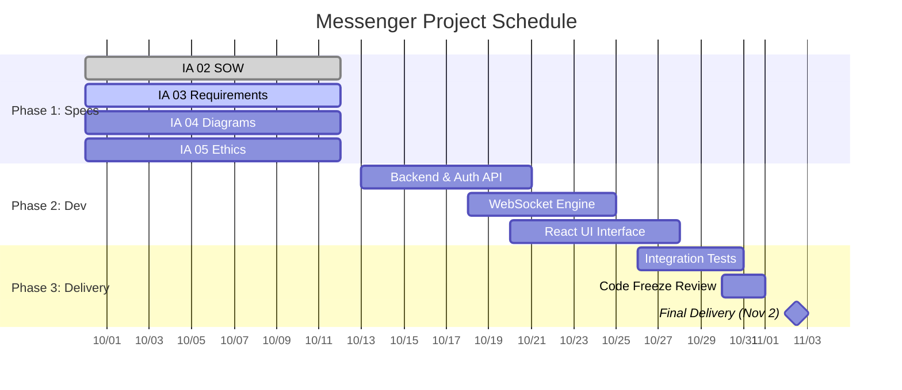

# Statement of Work: Messenger Application

## 1. Background and Problem Statement
Communication applications like Discord provide robust real-time interaction but introduce high complexity and heavy resource usage. Current light-weight communication solutions often fail to provide a single, synchronized view of real-time multi-user and private conversations. The Messenger project addresses this problem by building a bounded, accessible web communication system focused strictly on low-latency messaging, data persistence, and clear state management.

## 2. Project Purpose and Objectives
The objective of this project is to deliver a functional, verified real-time messaging application and complete documentation package.

### Core Objectives
* **User Identity & Access:** Allow users to register, log in, and maintain authenticated messaging sessions.
* **Private Messaging Pilot:** Enable two registered users to exchange private 1-on-1 text messages in real time without manual browser refreshes.
* **Group Messaging Pilot:** Enable users to create group channels and broadcast messages concurrently to all online group members.
* **Message Persistence:** Retain chat records across user sessions so historical messages remain retrievable upon re-authentication.

## 3. Stakeholders
* **Course Instructor / Client (CPS 490):** Project sponsor and primary review authority. Defines course requirements, evaluates project artifacts, and performs final acceptance reviews.
* **Student Software Engineer (Author):** Responsible for architecture, implementation, testing, schedule management, and artifact maintenance.
* **End Users (Borrowers/Senders/Receivers):** Registered users who consume the system to send/receive direct messages and manage group participation.

## 4. Scope Boundary

### Product Scope (System Capabilities)
* **In-Scope:**
  * User registration, authentication, and session token verification.
  * 1-on-1 real-time direct messaging between registered users.
  * Group messaging space creation and multi-user message distribution.
  * Server-side database persistence for user accounts and chat messages.
  * Online/offline user presence indicators.
* **Explicitly Out-of-Scope:**
  * Voice and video streaming/calls.
  * File, image, or media attachments.
  * Automated bot APIs, webhooks, or external integrations.
  * End-to-end encryption (E2EE) protocols.
  * Complex multi-role permissions or admin hierarchy management.

### Project Scope (Engineering Activities & Deliverables)
* System analysis, requirements engineering, and architectural modeling (`docs/`).
* Full-stack application implementation.
* Automated unit testing, integration verification, and deployment setup scripts.

## 5. Deliverables and Acceptance Evidence

| Deliverable ID | Deliverable | Description & Recipient | Acceptance Evidence |
| :--- | :--- | :--- | :--- |
| **D1** | **Specification Package** | Complete documentation (`docs/`) including SOW, Requirements, Analysis Diagrams, and Ethics Reflection submitted to GitHub. | Evaluated against course rubrics; all required repository paths present and rendered cleanly. |
| **D2** | **Core Messaging Application** | Runnable MERN application source code supporting direct and group chat. | **Given** two authenticated users, **When** User A sends a private message to User B, **Then** the message appears in User B's UI in under 2 seconds without page refresh. |
| **D3** | **Deployment & Verification Handoff** | Runnable setup script, database seed files, and automated unit/integration test suite. | Setup script successfully builds local environment; automated test suite passes 100% of functional verification cases. |

## 6. Constraints, Assumptions, and Dependencies

### Constraints
* **Final Delivery Deadline:** Complete system and handoff artifacts must be finalized no later than **November 2, 2026**.
* **Source Control:** All deliverables must be version-controlled in the assigned GitHub repository.

### Open Assumptions & Uncertainty Management
| Open Item / Assumption | Impact / Risk | Owner | Decision Point / Target Date |
| :--- | :--- | :--- | :--- |
| **WebSocket Scaling:** Single-server Socket.io setup can handle concurrent group connections without a redis pub/sub backplane | High concurrent load could dropped messages. | Student Engineer | **Oct 20, 2026:** Test local socket performance under 20 concurrent connections. |
| **Authentication Strategy:** JWT session tokens stored in local storage satisfy security obligations for the pilot. | Security review flags storage method. | Student Engineer | **Oct 15, 2026:** Confirm auth pattern in `docs/requirements.md`. |

### Dependencies
* Availability of Node.js runtime and MongoDB instance in the development environment.

## 7. Schedule and Milestones

### Key Milestones
* **M1: Specification Baseline (Oct 12, 2026):** Documentation suite (IA 02 – IA 05) committed and pushed to GitHub.
* **M2: Backend & Real-Time Core (Oct 24, 2026):** API endpoints and WebSocket message exchange verified.
* **M3: Feature Freeze & Verification (Oct 30, 2026):** All functional tests pass; code freeze enforced.
* **M4: Final Acceptance Delivery (Nov 2, 2026):** Final handoff and repo review completed.

## 8. Acceptance and Change Management
* **Acceptance Authority:** The Course Instructor/Client holds final approval authority based on observable test evidence and demonstration scripts.
* **Change Request Procedure:** Any proposed changes to scope or features (e.g., adding file attachments) must be recorded in an issue card, assessed for schedule impact against the Nov 2 deadline, and documented in Git history prior to implementation.
